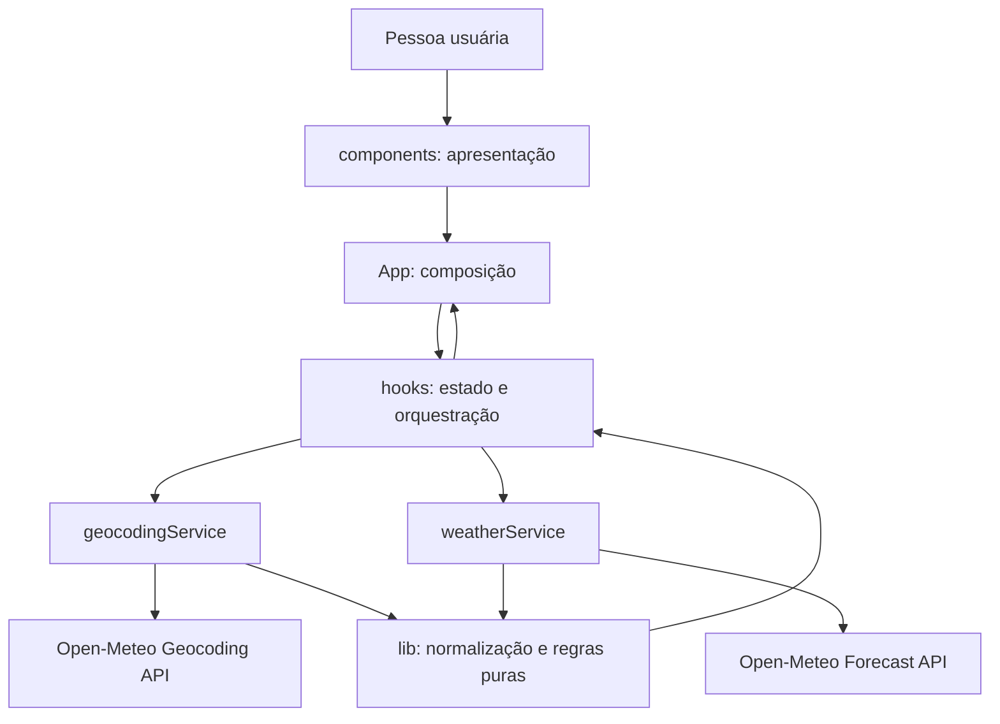
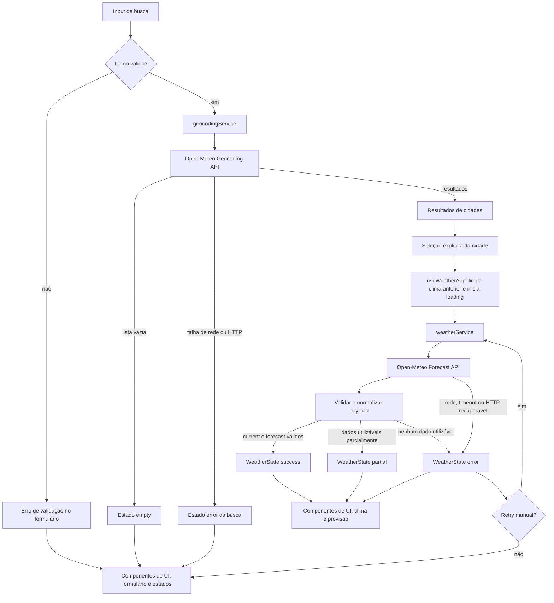

# Plano Técnico — Weather App

## Architecture

Aplicação web estática, client-side, sem backend próprio. A arquitetura separa apresentação, orquestração, I/O externo e regras puras. As dependências apontam para dentro: componentes usam contratos e callbacks; hooks coordenam componentes e services; services usam tipos e funções de `lib`; `lib` não depende de React, rede ou UI.



Responsabilidades e limites:

- **`components/`:** componentes de apresentação acessíveis; recebem dados/estado e callbacks por props. Não fazem fetch nem mantêm estado de domínio compartilhado. Exceção: estado efêmero estritamente visual, como foco, pode permanecer local.
- **`hooks/`:** estado da jornada, transições, seleção, retry e concorrência. Chamam services e entregam view state/actions para `App`; não montam URL nem interpretam DTOs do provedor.
- **`services/`:** fronteira de I/O. Constroem requisições, timeout/cancelamento, verificam HTTP/JSON, validam payloads e mapeiam respostas externas para contratos internos. Não importam componentes/hooks.
- **`lib/`:** funções determinísticas sem efeitos colaterais: validação/normalização do termo, códigos WMO, conversão de temperatura e formatação de data. Sem React, fetch ou estado global.
- **`types/`:** contratos de domínio compartilhados entre hooks, services e componentes; não contém lógica executável.
- **Testabilidade:** componentes recebem props previsíveis; hooks podem ser testados com services mockados; services testam I/O com `fetch` controlado; funções de `lib` são testadas diretamente por entrada/saída.
- **Persistência:** nenhuma. A unidade começa em Celsius após cada carga da página; os dados vivem apenas em memória.

## Tech Stack

- **TypeScript strict:** contratos internos explícitos e validação de valores externos em runtime.
- **React 19 + Vite 8:** interface SPA e servidor/build já configurados no projeto.
- **Tailwind CSS 3:** estilo conforme a convenção do repositório.
- **Open-Meteo:** geocodificação e previsão sem chave de API.
- **Vitest + Testing Library + user-event:** testes unitários e de interação.
- **Playwright:** testes E2E em Chromium desktop e perfil mobile já previstos na configuração.
- **Biome:** lint e verificações do código.
- **pnpm:** gerenciador declarado pelo repositório.

Não é necessária nova dependência de runtime. Usar `fetch`, `AbortController`, `Intl.DateTimeFormat` e os recursos já disponíveis no navegador; validar a compatibilidade com as versões cobertas pelo plano de testes.

## Project Structure

Estrutura proposta; `src/` e `tests/` ainda não existem no repositório.

```text
src/
  main.tsx
  App.tsx
  components/
    CitySearchForm.tsx
    CityResults.tsx
    CurrentWeather.tsx
    FiveDayForecast.tsx
    TemperatureUnitControl.tsx
    StatusMessage.tsx
  hooks/
    useWeatherApp.ts
  services/
    geocodingService.ts
    weatherService.ts
  types/
    weather.ts
  lib/
    searchTerm.ts
    weatherCodes.ts
    temperature.ts
    dateTime.ts
  styles/
    index.css
tests/
  unit/
    services/
    lib/
    components/
  e2e/
```

Manter um componente por arquivo. Os testes E2E ficam em `tests/e2e`, diretório já definido em `playwright.config.ts`; testes Vitest ficam em `tests/unit` e usam sufixos `.test.ts`/`.test.tsx`.

## Data Model

Modelos internos são independentes do contrato HTTP. Temperaturas canônicas são Celsius; coordenadas e medidas são números validados. Campos opcionais não disponíveis são omitidos, nunca preenchidos com valores artificiais. `null` em um resultado de seção significa que o conjunto inteiro está indisponível.

```ts
/** Unidade de apresentação; não altera os valores canônicos armazenados. */
export type Unit = "celsius" | "fahrenheit";

/** Localidade normalizada a partir da Geocoding API. */
export interface City {
  /** Identificador da localidade no provedor, quando informado. */
  id?: number;
  /** Nome da cidade retornado pela geocodificação. */
  name: string;
  /** País da localidade, quando informado pelo provedor. */
  country?: string;
  /** Código ISO do país, quando informado. */
  countryCode?: string;
  /** Região ou estado administrativo, quando informado. */
  region?: string;
  /** Latitude validada, usada para consultar a previsão. */
  latitude: number;
  /** Longitude validada, usada para consultar a previsão. */
  longitude: number;
  /** Fuso IANA informado pela Geocoding API, quando disponível. */
  timezone?: string;
}

/** Condições estimadas para o horário atual informado pelo provedor. */
export interface CurrentWeather {
  /** Temperatura atual normalizada em graus Celsius. */
  temperatureC: number;
  /** Horário local do provedor no fuso de WeatherData, formato YYYY-MM-DDTHH:mm. */
  timestamp: string;
  /** Código WMO; códigos desconhecidos produzem descrição indisponível. */
  weatherCode?: number;
  /** Umidade relativa em porcentagem. */
  humidityPercent?: number;
  /** Velocidade do vento normalizada em quilômetros por hora. */
  windSpeedKmh?: number;
  /** Precipitação atual normalizada em milímetros. */
  precipitationMm?: number;
}

/** Previsão para uma posição do calendário local da cidade. */
export interface ForecastDay {
  /** Data YYYY-MM-DD no fuso da cidade; null preserva um slot com data inválida. */
  date: string | null;
  /** Código WMO da condição prevista; pode estar ausente ou ser desconhecido. */
  weatherCode?: number;
  /** Máxima do dia em graus Celsius. */
  temperatureMaxC?: number;
  /** Mínima do dia em graus Celsius. */
  temperatureMinC?: number;
  /** Probabilidade máxima diária de precipitação em porcentagem. */
  precipitationProbabilityPercent?: number;
}

/** Resultado independente de cada seção, permitindo sucesso parcial. */
export type SectionResult<T> =
  | { status: "success"; data: T }
  | { status: "unavailable"; reason: WeatherErrorCode };

/** Resposta normalizada para a cidade selecionada. */
export interface WeatherData {
  /** Localidade usada como referência da consulta. */
  city: City;
  /** Fuso IANA retornado pelo Forecast API e usado para datas/horários. */
  timezone: string;
  /** Dados atuais ou motivo de indisponibilidade dessa seção. */
  current: SectionResult<CurrentWeather>;
  /** Lista ordenada com cinco posições locais ou motivo de indisponibilidade. */
  forecast: SectionResult<ForecastDay[]>;
}

/** Causas normalizadas de indisponibilidade de uma seção meteorológica. */
export type WeatherErrorCode =
  | "network"
  | "timeout"
  | "provider"
  | "invalid-response";
```

`forecast` contém cinco posições em ordem de calendário local. Se uma data estiver ausente ou inválida, o slot permanece com `date: null` e campos meteorológicos ausentes; dados inválidos em um dia não removem os demais. Uma falha que invalide todo o conjunto usa `status: "unavailable"`. A falha de uma seção não apaga a outra. A unidade de exibição é mantida separadamente em `Unit`; valores do modelo nunca são sobrescritos durante conversões.

Conversão para Fahrenheit: $F = C \times 9/5 + 32$, arredondando ao inteiro mais próximo, com empate para longe de zero. A conversão parte sempre do valor canônico em Celsius, não de um valor previamente convertido.

## Data Flow



`useWeatherApp` ignora respostas de operações anteriores; falhas de geocoding permanecem na busca e não iniciam Forecast. Datas e horários são formatados em `pt-BR` no timezone retornado. A troca de unidade deriva os valores na renderização e não percorre o caminho de rede.

## External APIs

### Geocoding

- **URL:** `https://geocoding-api.open-meteo.com/v1/search?name={query}&count=10&language=pt&format=json`
- **Parâmetros:** `name` recebe o termo aparado e codificado com `URLSearchParams`; `count=10` limita os resultados; `language=pt` solicita nomes/localizações em português quando disponíveis; `format=json` fixa o formato da resposta.
- **Resposta resumida:**

```json
{
  "results": [
    {
      "id": 3448439,
      "name": "São Paulo",
      "latitude": -23.55,
      "longitude": -46.63,
      "timezone": "America/Sao_Paulo",
      "country": "Brazil",
      "country_code": "BR",
      "admin1": "São Paulo"
    }
  ]
}
```

- **Mapeamento para `City`:** `id` → `id`; `name` → `name`; `country` → `country`; `country_code` → `countryCode`; `admin1` → `region`; `latitude`/`longitude` → coordenadas; `timezone` → `timezone`. Campos de localidade opcionais ausentes são omitidos. Preserve a ordem e não use a primeira cidade automaticamente; vazio/ausente em uma resposta HTTP válida vira resultado vazio.

### Forecast

- **URL:** `https://api.open-meteo.com/v1/forecast?latitude={lat}&longitude={lon}&current=temperature_2m,weather_code,relative_humidity_2m,wind_speed_10m,precipitation&daily=weather_code,temperature_2m_max,temperature_2m_min,precipitation_probability_max&timezone=auto&forecast_days=5&temperature_unit=celsius&wind_speed_unit=kmh&precipitation_unit=mm`
- **Parâmetros:** coordenadas da `City` selecionada; `current` e `daily` selecionam os campos consumidos; `timezone=auto` solicita o fuso da coordenada; `forecast_days=5` solicita hoje e os quatro dias seguintes; unidades solicitadas são °C, km/h e mm.
- **Resposta resumida:**

```json
{
  "timezone": "America/Sao_Paulo",
  "current_units": {
    "time": "iso8601",
    "temperature_2m": "°C",
    "relative_humidity_2m": "%",
    "wind_speed_10m": "km/h",
    "precipitation": "mm",
    "weather_code": "wmo code"
  },
  "current": {
    "time": "2026-09-30T12:30",
    "temperature_2m": 20.0,
    "relative_humidity_2m": 65,
    "wind_speed_10m": 12.0,
    "precipitation": 0.0,
    "weather_code": 0
  },
  "daily_units": {
    "time": "iso8601",
    "weather_code": "wmo code",
    "temperature_2m_max": "°C",
    "temperature_2m_min": "°C",
    "precipitation_probability_max": "%"
  },
  "daily": {
    "time": ["2026-09-30", "2026-10-01", "2026-10-02", "2026-10-03", "2026-10-04"],
    "weather_code": [0, 2, 61, 3, 1],
    "temperature_2m_max": [24.0, 25.0, 22.0, 21.0, 23.0],
    "temperature_2m_min": [15.0, 16.0, 14.0, 13.0, 15.0],
    "precipitation_probability_max": [0, 10, 70, 20, 0]
  }
}
```

- **Mapeamento para `WeatherData`:** `city` é a `City` selecionada; `timezone` vem do campo raiz `timezone` e é obrigatório para formatar a data/hora local.
- **Mapeamento de `current` para `CurrentWeather`:** `current.temperature_2m` → `temperatureC`; `current.time` → `timestamp` local, interpretado em `WeatherData.timezone`; `current.weather_code` → `weatherCode`; `relative_humidity_2m` → `humidityPercent`; `wind_speed_10m` → `windSpeedKmh`; `precipitation` → `precipitationMm`.
- **Mapeamento de `daily` para `ForecastDay[]`:** cada índice `i` dos arrays alinhados forma um item: `daily.time[i]` → `date`; `weather_code[i]` → `weatherCode`; `temperature_2m_max[i]`/`temperature_2m_min[i]` → `temperatureMaxC`/`temperatureMinC`; `precipitation_probability_max[i]` → `precipitationProbabilityPercent`. Mantenha cinco posições na ordem recebida; índice ausente/inválido produz campos ausentes e `date: null` quando a própria data for inválida.
- **Validação/normalização:** confirme status HTTP, JSON, tipos finitos e unidades declaradas em `current_units`/`daily_units`. Como a requisição pede °C, km/h e mm, rejeite unidades incompatíveis em vez de interpretar silenciosamente. Ausência de campos opcionais omite apenas o campo; ausência de `timezone`, temperatura/timestamp atual ou arrays diários obrigatórios torna a seção correspondente indisponível. As seções `current` e `forecast` são normalizadas independentemente para suportar sucesso parcial.
- `Unit` não vem do payload: é estado local de apresentação, inicia em `celsius` e só altera a conversão dos valores canônicos recebidos em Celsius.

Ambas as APIs são chamadas diretamente do navegador via HTTPS e não exigem segredo. Os serviços devem lidar com erros HTTP, JSON malformado e respostas válidas porém incompletas. Termos, limites de uso e atribuição são gates antes do release, conforme a spec.

## State Management

Todo estado de domínio vive em `useWeatherApp`, chamado por `App`; não usar Context/global store nem persistência. O texto ainda não enviado fica no estado efêmero de `CitySearchForm`. Após submit, termo normalizado, resultados, cidade selecionada, clima e unidade pertencem ao hook; `App` encaminha dados e ações por props. A busca e a consulta meteorológica têm estados independentes.

Estados discriminados:

```ts
type SearchState =
  | { status: "idle" }
  | { status: "loading"; term: string }
  | { status: "success"; term: string; results: City[] }
  | { status: "empty"; term: string }
  | { status: "error"; term: string; error: AppError };

type WeatherState =
  | { status: "idle" }
  | { status: "loading"; city: City }
  | { status: "success"; data: WeatherData }
  | { status: "partial"; data: WeatherData }
  | { status: "error"; city: City; error: AppError };

type AppError = {
  code: "network" | "timeout" | "provider" | "invalid-response";
  message: string;
  retryable: boolean;
};
```

`empty` é exclusivo da busca de cidade: resposta de geocoding válida com zero resultados. `success` da previsão significa dados atuais e os cinco slots diários utilizáveis; `partial` significa que ao menos uma seção/dia é utilizável e outra seção ou slot obrigatório está indisponível; `error` significa falha sem dados meteorológicos utilizáveis. Campos opcionais ausentes, por si só, não tornam o clima parcial.

Transições principais: busca iniciada → `loading` → `success`, `empty` ou `error`; cidade selecionada → clima `loading` → `success`, `partial` ou `error`. Ao escolher cidade nova, limpar o clima antigo imediatamente. Uma resposta só atualiza seu estado se o identificador da operação ainda for o mais recente; cancelamento por substituição é silencioso e não vira erro visível.

`Unit` vive no hook, inicia em `celsius` e permanece durante a sessão da página. Os valores armazenados em `WeatherData` permanecem em Celsius. Na renderização, um seletor/função pura de `lib/temperature.ts` recebe o valor canônico e `Unit`, calcula °F com a fórmula e arredondamento definidos em Data Model e formata o sufixo. Não guardar valores convertidos e não disparar efeito ou request ao alternar unidade; aplicar a conversão à temperatura atual e a todas as máximas/mínimas.

O retry repete apenas a operação que falhou e somente após ação explícita; uma ativação envia no máximo uma chamada. A busca pode continuar enquanto o clima carrega.

## Error Handling

- **Validação de entrada:** campo vazio ou com caracteres de controle; mostrar erro associado ao campo, não chamar API e não oferecer retry.
- **Geocoding sem resultados:** usar estado `empty` e “Nenhuma cidade encontrada. Confira o nome e tente novamente.”; não consultar Forecast. É distinto de erro de API.
- **Falha de rede:** mapear rejeição de `fetch` para `network`; encerrar loading, mostrar “Não foi possível conectar. Tente novamente.” e habilitar retry manual.
- **Timeout:** abortar a chamada após 10 s e mapear para `timeout`; mostrar “A consulta demorou demais. Tente novamente.”. Uma resposta recebida após o timeout é ignorada.
- **HTTP 429/5xx:** mapear para `provider`; permitir retry manual e, se houver `Retry-After`, não enviar a nova chamada antes do instante indicado. Não fazer retry automático.
- **HTTP 4xx exceto 429:** mapear como erro não recuperável da requisição; mensagem de indisponibilidade e nova busca disponível, sem retry da mesma chamada.
- **JSON inválido/unidades incompatíveis/payload sem estrutura necessária:** mapear para `invalid-response`; não renderizar dados não validados e oferecer retry manual para a consulta meteorológica.
- **Resposta parcial:** normalizar `current` e `forecast` independentemente. Campo opcional ausente é omitido; falta de temperatura/timestamp atual torna `current` indisponível; slots diários inválidos permanecem sinalizados como indisponíveis. Se uma seção ainda tiver dados, usar estado `partial`; se nenhuma tiver, usar `error`.
- **Concorrência/cancelamento:** cancelar chamadas substituídas com `AbortController` e ignorar toda resposta cujo identificador não seja o atual. Cancelamento intencional não mostra erro nem retry.
- **Diagnóstico:** registrar somente os campos permitidos pela RNF-05; nunca termo de busca, coordenadas ou identificadores pessoais.

## Testing Strategy

- **Vitest — funções puras de `lib/`:** conversão C↔F, arredondamento de empate para longe de zero, valores negativos e ausência de deriva ao alternar repetidamente; limites dos intervalos WMO e código desconhecido; trim/validação do termo; datas, virada do dia e formatação em fusos diferentes. Entradas e saídas diretas, sem DOM, rede ou mocks.
- **Vitest — `services/`:** mockar `fetch` para verificar URL e parâmetros, codificação de acentos, limite/ordem do geocoding, mapeamento DTO→modelo, unidades, arrays diários desalinhados, campos opcionais, resposta parcial, JSON inválido, HTTP 4xx/429/5xx, timeout, abort e `Retry-After`. Usar relógio/fake timers para não aguardar 10 s reais.
- **Testing Library — `components/`:** passar props fixas e verificar os estados `loading`, `error`, `empty` e `success` (além de `partial`), conteúdo e nomes acessíveis, retry, unidade ativa e operação por teclado. Confirmar que a apresentação não inicia requests.
- **Testing Library — `hooks/`:** mockar services e verificar transições de `SearchState`/`WeatherState`, seleção explícita, limpeza da cidade anterior, latest response wins, cancelamento silencioso, retry manual e mudança de unidade sem nova chamada.
- **Playwright — E2E:** interceptar ambas as APIs com `page.route`; percorrer busca → resultados → seleção → clima atual/previsão de cinco dias; cobrir cidade homônima, lista vazia, falha e retry, estado parcial e alternância C/F sem nova chamada. Testar resposta fora de ordem com duas requisições controladas.
- **Playwright — mobile:** usar o projeto mobile já configurado; repetir busca, seleção, leitura dos cinco dias e unidade em viewport mobile; verificar controles acionáveis, conteúdo legível e `scrollWidth <= clientWidth` para não haver rolagem horizontal.
- **Acessibilidade e release:** automatizar auditoria nos estados inicial, resultados, loading, erro e clima; validar teclado/leitor de tela manualmente. Executar `pnpm lint`, `pnpm build`, `pnpm test` e `pnpm test:e2e`, mais as verificações de performance/SLO de RNF-03/RNF-06.

E2E não depende de serviços ao vivo: isso mantém os resultados reproduzíveis. A validação real do contrato Open-Meteo fica coberta por testes de service com fixtures e deve ser complementada por monitoramento operacional após o release.

## Risks & Trade-offs

| Decisão | Alternativa considerada | Trade-off |
|---|---|---|
| Chamar Open-Meteo diretamente do browser | Backend proxy próprio | Evita backend, segredo e custo operacional; aumenta dependência do provedor, expõe metadados da requisição ao cliente e deixa disponibilidade externa fora do controle do app. Timeout, validação e retry manual reduzem impacto. |
| Estado local em `useWeatherApp` | Biblioteca global ou Context | Menos infraestrutura para uma única jornada; estado não é compartilhado entre rotas/componentes independentes. Adotar store apenas se surgirem múltiplas áreas consumidoras ou persistência. |
| Celsius canônico; Fahrenheit derivado na renderização | Solicitar/reter payloads nas duas unidades | Uma fonte numérica e nenhuma nova chamada ao alternar; exige arredondamento determinístico e testes para negativos/empates. |
| Sem cache persistente | Cache de memória/localStorage e modo offline | Evita exibir dados vencidos e simplifica privacidade; cada nova seleção precisa de rede e não há consulta offline. |
| Retry somente manual | Retry automático com backoff | Evita tráfego/custos repetidos e respeita o controle da pessoa usuária; recuperação exige ação explícita. `Retry-After` é respeitado antes de permitir a nova chamada. |
| Abortar e ignorar respostas obsoletas | Permitir todas as requisições terminarem | Pequena complexidade de cancelamento/identificador evita que dados de busca antiga sobrescrevam a cidade atual. |
| E2E com APIs interceptadas | E2E contra Open-Meteo ao vivo | Execução determinística e sem dependência externa; não detecta sozinha mudanças reais do provedor. Testes de service/monitoramento cobrem esse risco. |